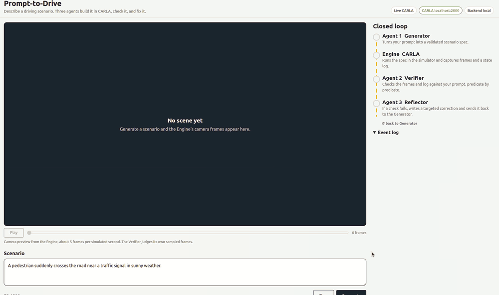
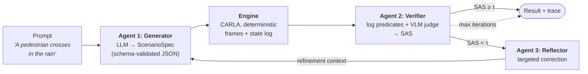

<div align="center">

# Prompt-to-Drive

**Type a driving scenario in plain English. Three AI agents build it in CARLA, check it, and fix it.**

[](https://github.com/OWNER/prompt2drive/actions/workflows/tests.yml)


[](LICENSE)




[Quick start](#quick-start) ·
[How it works](#how-it-works) ·
[Results](#results) ·
[Reproduce the paper](docs/EVALUATION.md) ·
[Limitations](#limitations) ·
[Cite](#citation)

</div>

---

Most LLM-to-simulator pipelines stop at *"the scenario ran"*. Prompt-to-Drive also asks **"did it run what was asked for?"**, and measures how much that answer depends on which model does the checking.

- **Schema, not free-form code.** The Generator writes a validated `ScenarioSpec`, not raw CARLA Python. Executable success goes from **28% to 100%** on our 25-scenario benchmark.
- **Verification as its own layer.** A Verifier scores every run with a *Semantic Alignment Score* (SAS) that combines deterministic state-log predicates with a vision-language model (VLM) judge.
- **Swappable judges.** The same recorded runs scored by three open VLMs differ by up to **0.175 SAS**, and one of them gives a perfect score to every adversarial scenario. Report a verifier sensitivity check with your alignment numbers.
- **A closed loop you can watch.** When a check fails, the Reflector writes a targeted correction and the loop runs again, with every step visible in the web UI.

## Quick start

### Option A: watch recorded runs (no CARLA, no GPU, 2 minutes)

```bash
git clone https://github.com/OWNER/prompt2drive.git && cd prompt2drive
python -m venv .venv && source .venv/bin/activate
pip install -r requirements-ui.txt
python -m webui.server --mode replay --runs-dir demo_runs
# open http://127.0.0.1:8080 and pick a recorded prompt
```

Or with Docker: `docker build -t prompt2drive-demo . && docker run -p 8080:8080 prompt2drive-demo`.

Replay re-streams real recorded runs (`pipeline_run.json` + frames). Nothing is regenerated or re-scored.

### Option B: run it live

You need CARLA 0.9.16, a GPU, and either an OpenAI key or a local [vLLM](https://github.com/vllm-project/vllm) server.

```bash
pip install -r requirements.txt
pip install <CARLA_ROOT>/PythonAPI/carla/dist/carla-0.9.16-cp310-*.whl
cp .env.example .env            # choose backends, set keys / model names

# terminal 1: a vision model on vLLM (example: Qwen2.5-VL-7B-AWQ)
VLLM_USE_FLASHINFER_SAMPLER=0 vllm serve <path>/Qwen2.5-VL-7B-Instruct-AWQ \
  --served-model-name Qwen/Qwen2.5-VL-7B-Instruct --max-model-len 4096 \
  --gpu-memory-utilization 0.45 --max-num-seqs 1 --max-num-batched-tokens 4096 \
  --enforce-eager --limit-mm-per-prompt '{"image":3}'

# terminal 2: starts CARLA, loads the map, opens the web UI
tools/start_demo.sh
```

`tools/start_demo.sh --threshold 1.0` makes every failed check trigger the Reflector, which is the best way to watch the whole loop. Details and the other models: [docs/WEB_UI.md](docs/WEB_UI.md).

A single scenario from the command line:

```bash
python run_scenario.py --prompt "A pedestrian crosses near a traffic signal in rain." \
  --hardware-profile low_vram_2gb
```

## How it works



| Stage | What it does | Where |
|---|---|---|
| **Generator** | Prompt → `ScenarioSpec` (weather, town, vehicles, pedestrian, event, duration), validated with Pydantic before anything touches CARLA | [`generator/`](generator/) |
| **Engine** | Turns the spec into CARLA API calls under a hardware profile, records frames and a structured state log | [`engine/`](engine/) |
| **Verifier** | Deterministic state-log checks + VLM predicates over sampled frames (majority vote over 3 calls) → SAS ∈ [0, 1]; pass if SAS ≥ τ = 0.75 | [`verifier/`](verifier/) |
| **Reflector** | Maps each failed predicate to a targeted correction for the next Generator call; bounded by `--max-iterations` | [`reflector/`](reflector/) |

**Scoring, as implemented.** `SAS = 0.5 · VLM predicate agreement + 0.3 · state-log checks passed + 0.2 · execution success`. Every score in the traces and tables comes from this formula ([`verifier/agent.py`](verifier/agent.py), full definition in [docs/EVALUATION.md](docs/EVALUATION.md#metric-definition)).

Model access sits behind one small interface ([`backends/llm_backend.py`](backends/llm_backend.py)): OpenAI, Hugging Face Inference, or any local vLLM server. Every run writes a complete trace to `outputs/<scenario_id>/pipeline_run.json`: prompt, spec, predicates, reflections, latencies and memory.

## Results

From the paper, on a 25-scenario benchmark (5 weather × 6 event types × 3 difficulty levels) and a 10-scenario adversarial stress set. Generator and Reflector: GPT-4o. Every number is computed by `eval/compute_metrics.py` from the preserved traces.

**Executability**

| Condition | Executable success |
|---|---|
| Free-form CARLA code (baseline) | 0.28 |
| Schema-constrained Generator | 1.00 |
| Full closed loop | 1.00 |

**Same traces, different judge**

| Verifier | Mean SAS, generator-only | Mean SAS, closed loop | Stress-set mean (σ) | Standard − stress gap |
|---|---|---|---|---|
| Llama-3.2-11B-Vision-Instruct | 0.732 | 1.000 | 1.000 (0.000) | 0.000 |
| Qwen2.5-VL-7B-AWQ | 0.732 | 0.825 | 0.758 (0.147) | 0.067 |
| InternVL2.5-8B-AWQ | 0.732 | 0.830 | 0.833 (0.091) | −0.003 |

Paired bootstrap (10,000 resamples): Llama − Qwen = 0.175, 95% CI [0.148, 0.198]; Llama − InternVL = 0.170 [0.133, 0.205]; Qwen − InternVL = −0.005 [−0.035, 0.028].

**What this means.** Llama scores every scenario, standard or adversarial, at 1.000, so it cannot tell easy from hard. Only Qwen's score moves with stress-set difficulty. That shows sensitivity, not accuracy: no human-annotated ground truth backs these predicates. An SAS of 0.83 means *"this verifier's weighted checks came out at 0.83"*, not *"83% semantically correct"*.

Per-predicate rates, reflection statistics and latency are in the paper and in [`eval/paper_results/`](eval/paper_results/).

## Repository layout

```
backends/       model access: OpenAI, Hugging Face, local vLLM
generator/      Agent 1: prompt → ScenarioSpec
engine/         ScenarioSpec schema, CARLA runner, hardware profiles
verifier/       Agent 2: log predicates + VLM judge → SAS
reflector/      Agent 3: failed predicates → targeted correction
orchestrator/   the closed loop, tracing and latency accounting
webui/          browser UI (FastAPI + WebSocket), live or replay
eval/           evaluation scripts; paper_results/ = the paper's tables per verifier
scenarios/      benchmark (25) and adversarial stress set (10)
demo_runs/      recorded runs used by replay mode and the Docker demo
tools/          start_demo.sh and CARLA diagnostics
tests/          unit tests, no CARLA / GPU / API key needed
docs/           WEB_UI, EVALUATION (reproduce + metric), TROUBLESHOOTING
```

## Limitations

Stated plainly so nobody has to discover them:

- **Events and cyclists are not scripted by the Engine.** `event_type` and `cyclist` are generated, validated and verified, but the Engine does not choreograph them. The ego drives on autopilot, and an event is only observable if traffic produces it. This is consistent with the low `event_observable` rates in the paper.
- **No human ground truth.** Verifier results measure sensitivity to stress conditions, not agreement with human judgment.
- **Reflection is rarely exercised** on this benchmark (1 to 2 of 25 scenarios per verifier), and correcting one predicate can break another (predicate regression).
- **One Generator/Reflector model** (GPT-4o) and N = 25 + 10 scenarios, with no repeated-run variance.
- **CARLA 0.9.16 map switching** can segfault once a Traffic Manager exists. The web UI therefore pins one town per session (`--pin-town`, used by `tools/start_demo.sh`). Details: [docs/TROUBLESHOOTING.md](docs/TROUBLESHOOTING.md).

## Citation

```bibtex
@inproceedings{ambigapathy2026prompttodrive,
  title     = {Prompt-to-Drive: Closed-Loop AI-Driven Scenario Synthesis and Verifier-Sensitive
               Semantic Alignment for Autonomous Driving Simulation},
  author    = {Ambigapathy, Narmada and Idrees, Fatima and Abah, John and Alhalabi, Ali and Rettberg, Achim},
  booktitle = {CAIESA Workshop at Embedded Systems Week (ESWEEK)},
  year      = {2026}
}
```


## Contributing

Issues and pull requests are welcome: new scenario types, predicates, backends or UI features.
Please run `pytest tests/ -q` first (no CARLA, GPU or API key needed), and say in the PR if a
change could alter a ScenarioSpec, a score or a latency compared with the paper's runs.
For bugs, include the CARLA version (server and pip client), the command, and the
`pipeline_run.json` of the failing scenario.

## License

[MIT](LICENSE)
